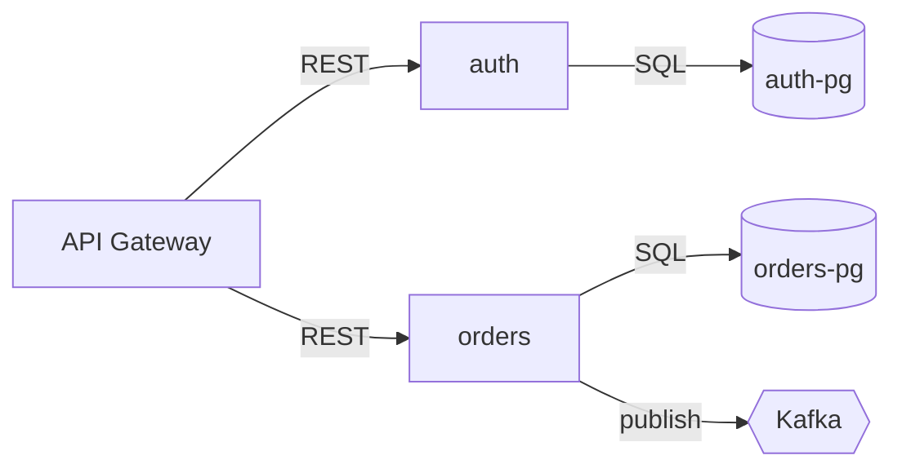

# AI-Generated Architecture Diagrams for GitLab

### Choosing a format, structuring the output, and prompting for it

*A working guide for generating system diagrams from a large context blob — optimized for AI ingestion, human readability, and native GitLab rendering.*

---

## TL;DR

**Use Mermaid.** It renders natively in GitLab with zero admin configuration, Claude writes and reads it accurately, and it diffs cleanly in merge requests.

**But do not make one giant diagram.** That is the part of the goal worth abandoning. Build a layered set of small diagrams, one file per level, plus a routing index. The format question is easy; the structure question is what determines whether this is useful in six months.

**Put the substance in a legend table, not in the diagram.** Mermaid encodes topology well and everything else badly. A markdown table keyed to node IDs gives humans a legend and gives the AI structured records, at almost no token cost.

---

## 1. Why one mega-diagram fails

Three separate walls, any one of which is fatal.

### GitLab caps Mermaid blocks at 5,000 characters

This is hardcoded client-side (`MAX_CHAR_LIMIT = 5000` in `render_mermaid.js`), introduced as a denial-of-service mitigation following CVE-2019-9220. A whole-system diagram blows past it easily and simply fails to render — you get an error message, not a picture. This is the hard constraint that decides the architecture, so design around it from the start rather than discovering it late.

### Mermaid's auto-layout degrades around 40–50 nodes

Mermaid uses dagre for layout and gives you no positioning control. Past roughly 40 nodes you get a hairball that technically renders and is practically unreadable. No engineer is going to comprehend an entire system as one picture regardless of how well it lays out.

### It is token-hostile for retrieval

If the AI needs to know how auth talks to the session store, loading a 4,000-token diagram of everything to find two edges is the up-front-loading anti-pattern. Small files let the model load only the level it needs.

---

## 2. The structure to build

Layered diagrams, C4-style, one file per level. Each file small enough to render and to load independently.

```
docs/architecture/
  index.md           # routing table: which file answers which question
  README.md          # L1 system context — your system + externals only (~10 nodes)
  containers.md      # L2 deployable units — services, DBs, queues (~20 nodes)
  components/
    auth.md          # L3 internals of one container
    orders.md
    ingest.md
  flows/
    checkout.md      # sequence diagrams for critical paths
    login.md
```

The layering maps to the C4 model: **Context** (your system as one box among externals), **Container** (deployable units), **Component** (inside one container). You rarely need C4's fourth level — code-level diagrams go stale immediately and the code is already the source of truth.

### `index.md` is the piece people skip

It is also the most valuable file for AI ingestion. It is a cheap routing table: one line per diagram file saying what question that file answers. The model reads roughly 200 tokens and knows which file to open, instead of loading all of them and discarding most.

Keep it under 300 words. It is an index, not a summary.

---

## 3. Format comparison

| Format | GitLab rendering | AI fluency | Token cost | Layout at scale | Verdict |
|---|---|---|---|---|---|
| **Mermaid** | Native, no config | Excellent | Low | Poor past ~40 nodes | **Default choice** |
| **PlantUML** | Needs a PlantUML or Kroki server | Very good | Higher — verbose syntax | Better than Mermaid | Good if you want C4-PlantUML macros |
| **Graphviz / DOT** | Kroki only | Good | Lowest | Best of the text formats | Best for genuinely large graphs |
| **D2** | Kroki, or render to SVG in CI | Moderate — newer, thinner training data | Low | Very good | Nice language, weakest AI support |
| **Structurizr DSL** | Render in CI | Moderate | Moderate | Excellent (generates multiple views from one model) | The "right" answer if you commit to it |
| **ASCII / ANSI art** | Renders as text | Poor | High | Terrible | Avoid |

Mermaid wins on the combination that matters here: it works today, the model is fluent in it, and a human can read the source without rendering it.

Structurizr deserves a mention because it solves the layering problem properly — you describe the model once and generate every view from it. The cost is a real toolchain and a DSL the model knows less well. If this becomes a long-lived team asset rather than a one-time generation, it is worth revisiting.

---

## 4. Is Mermaid actually good for AI ingestion?

Mostly yes, with one caveat worth being honest about.

**In its favor:**

- Enormous training representation. Claude writes and reads it accurately without you explaining syntax, and rarely produces invalid Mermaid.
- Line-oriented, so it diffs cleanly and reviews well in merge requests.
- Edges are extremely information-dense. `web -->|gRPC| auth` is roughly six tokens carrying source, target, and protocol.
- Stable node IDs act as a shared vocabulary across files, so the model can cross-reference.

**The caveat:** a diagram is a lossy context source. Mermaid encodes topology and almost nothing else. A model reading `auth --> pgdb` learns that an edge exists — not what is in that database, what the SLO is, which repo owns it, or what breaks when it is down. If you want the AI to understand the system rather than just its shape, the diagram alone will not get you there.

### The fix: diagram plus legend table

Put a markdown table directly under each diagram, keyed to the node IDs.

````markdown


| id | repo | owner | tech | notes |
|---|---|---|---|---|
| gw | infra/gateway | platform | Kong | terminates TLS, rate limits per-tenant |
| auth | svc/auth | identity | Go 1.22 | JWT issuer, 15m access / 7d refresh |
| orders | svc/orders | fulfillment | Java 21 | owns order state machine |
| authdb | — | identity | Postgres 16 | PII; separate backup policy |
| ordersdb | — | fulfillment | Postgres 16 | read replica for reporting |
| bus | infra/kafka | platform | Kafka 3.6 | `orders.*` topics, 7d retention |
````

Humans read it as a key. The model parses it as structured records tied to the node IDs it just read. You get contextual depth without paying for prose, and it costs nothing at render time.

**Rule for the notes column:** one line, and it should be the thing a new engineer would get wrong. Not "handles orders" — that is already visible. Something like "owns the order state machine; other services must not write to `orders_pg` directly."

---

## 5. Token efficiency rules

Ordered by how much they actually matter.

**Short node IDs.** The ID appears in every edge, so savings multiply. `auth` instead of `authenticationService`; with 60 edges that is real. Treat IDs as an API — they are referenced across files and in conversation, so keep them stable once chosen. Add a display label only when the ID is not self-explanatory.

**Edge labels are the best tokens you will spend.** Protocol, route, or direction: `-->|REST /v1/orders|`, `-->|async|`, `-->|publish orders.created|`. Highest information density in the entire file. Never leave an edge bare if you know what flows across it.

**Drop all `classDef`, `style`, and `linkStyle`.** Pure token cost, zero semantic content, and it is the first thing that makes a diagram exceed the 5,000-character cap. If you want color, use two or three classes applied by group — never per-node inline styling.

**`%%` comments are free at render time.** They are stripped from the rendered output but visible to anything reading the file. Useful for AI-only hints that would clutter the picture.

**Use `subgraph` only for real boundaries.** Network, cluster, trust boundary, or team ownership. It is cheap and it tells the model something true about isolation. Do not use it for cosmetic grouping.

**Skip decorative shapes** unless the shape carries meaning. `[(cylinder)]` for datastores and `{{hexagon}}` for queues are worth it because they encode type. Anything beyond that is noise.

---

## 6. Escaping the 5,000-character cap

If you self-host GitLab you have an option most people do not: **enable Kroki.**

Admin → Settings → General → Kroki → check *Enable Kroki* and set the URL to a server you run:

```bash
docker run -d --name kroki -p 8080:8000 yuzutech/kroki
```

Kroki renders server-side into an `` tag, which sidesteps the client-side Mermaid character limit entirely. It also unlocks Graphviz, C4-PlantUML, D2, BPMN, and roughly a dozen other libraries using the same fenced-block syntax in Markdown, AsciiDoc, reStructuredText, and Textile. The `yuzutech/kroki` image covers most diagram types out of the box; additional libraries need companion containers.

**Security note:** Kroki diagrams are not stored in GitLab and are not covered by GitLab's access controls or user permissions. Run your own instance rather than pointing at the public `kroki.io` if the architecture is sensitive.

**Recommendation:** start with plain Mermaid because it works today with no admin work. Add Kroki only when you hit a specific diagram that genuinely will not decompose — and reach for Graphviz rather than Mermaid at that point, since its layout is meaningfully better at high node counts.

---

## 7. The generation prompt

```
I want you to build a layered architecture diagram set for this system,
rendered in Mermaid, that lives in our GitLab repo.

CONTEXT SOURCE
[paste your blob, or: read @docs/, @src/, and the service manifests in @deploy/]

BEFORE YOU WRITE ANYTHING
1. Read the context and produce an inventory: every deployable unit, every
   datastore, every external dependency, every queue/topic. Just a list.
2. Show me the inventory and your proposed file split. Wait for my approval.
   Do not generate diagrams yet.

STRUCTURE — one file per level, not one giant diagram
- docs/architecture/README.md      L1 system context: our system as one box,
                                   plus external systems and actors. Max 12 nodes.
- docs/architecture/containers.md  L2: deployable units, datastores, queues.
                                   Max 25 nodes.
- docs/architecture/components/<name>.md  L3: internals of one container.
                                   One file per container, max 20 nodes each.
- docs/architecture/flows/<name>.md  sequence diagrams for critical paths only.
- docs/architecture/index.md       routing table: one line per file saying what
                                   question it answers. Keep under 300 words.

HARD CONSTRAINTS
- GitLab caps Mermaid blocks at 5000 characters. Every block must be well
  under that. If a diagram approaches the cap, split it and tell me.
- Mermaid only, in ```mermaid fences. No ASCII art, no images, no HTML.
- Use flowchart syntax for structure, sequenceDiagram for flows.

TOKEN AND STYLE RULES
- Node IDs: short, lowercase, stable (auth, orders, gw). These are identifiers
  other files and I will reference — treat them as an API.
- Display labels only when the ID isn't self-explanatory.
- Every edge gets a label naming the protocol or the payload
  (-->|REST|, -->|gRPC|, -->|publish orders.created|).
- No classDef, no style, no linkStyle. Zero decoration.
- Use subgraph only for real boundaries: network, cluster, or ownership.

LEGEND TABLE (required, under every diagram)
A markdown table with columns: id | repo | owner | tech | notes.
One row per node in that diagram, keyed to the exact node ID.
Notes column: one line, the thing a new engineer would get wrong.
This table is the context payload — put the substance here, not in the diagram.

ACCURACY
- Derive everything from the source I gave you. Do not infer components that
  aren't evidenced.
- Where the source is ambiguous or silent, add a row to an "## Unknowns"
  section at the bottom of the file naming exactly what you couldn't determine.
  Do not guess and do not paper over gaps.
- Cite where each non-obvious claim came from (file path or section).

VERIFY BEFORE YOU FINISH
- Print the character count of every mermaid block.
- Confirm every node ID in a diagram has a legend row, and vice versa.
- Confirm no node ID is used with two different meanings across files.
```

### The two clauses doing the most work

**The inventory-first gate.** Without it, the model starts drawing before it knows the scope and you get a confidently wrong diagram that looks finished. Forcing a flat list first separates discovery from rendering, and the list is cheap to correct — the diagram is not.

**The Unknowns section.** Without it, gaps get filled with plausible-looking services that do not exist. This is the single worst failure mode for architecture documentation, because it is invisible on review and nobody catches it for months. An explicit place to record "I could not determine X" converts a silent fabrication into a visible TODO.

---

## 8. Keeping it from going stale

A generated diagram is a snapshot, and an architecture doc that lies is worse than no doc. Two low-effort guards:

**A CI check on node IDs.** Parse the legend tables, extract the `repo` column, and fail the pipeline if a referenced repo no longer exists. Cheap, catches the most common form of drift.

**Regenerate on a cadence, diff rather than replace.** Re-run the prompt quarterly against fresh context and review the diff as a merge request. The diff is the interesting artifact — it shows you what actually changed in the system. Replacing the files wholesale throws that signal away.

If you are already building a context-ingestion pipeline over Jira, GitLab, and Confluence, the diagram set is a natural output of it: the same cached markdown that feeds the AI can feed the regeneration step, so the diagrams and the context store never drift from each other.

---

## Sources and caveats

The 5,000-character Mermaid limit is documented in GitLab's own issue tracker (`gitlab-org/gitlab#207229`, requesting the limit be made configurable) and traces to the CVE-2019-9220 mitigation. It has been a long-standing request to raise it; verify against your own instance before designing around a different number.

Kroki details come from GitLab's administration documentation for self-managed instances (introduced in GitLab 13.7, extended to reStructuredText and Textile in 13.12).

Node-count thresholds for readable Mermaid layout are practitioner rules of thumb, not measured limits — treat 40 as a signal to split, not a hard rule.
